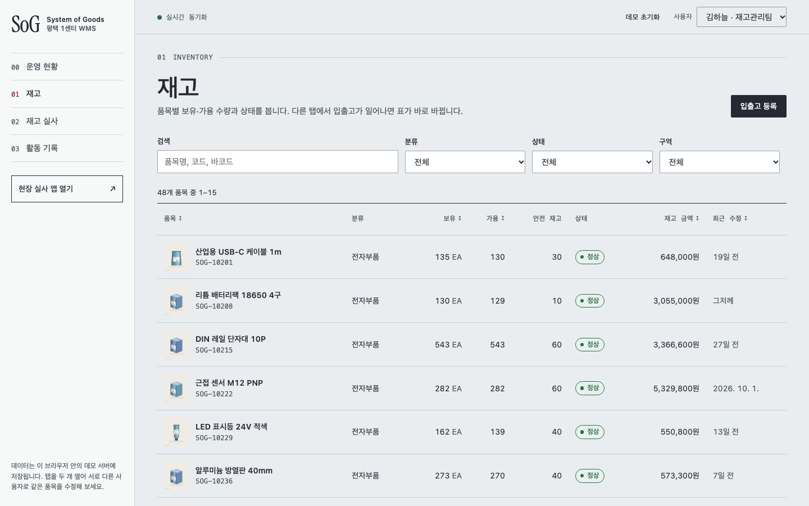
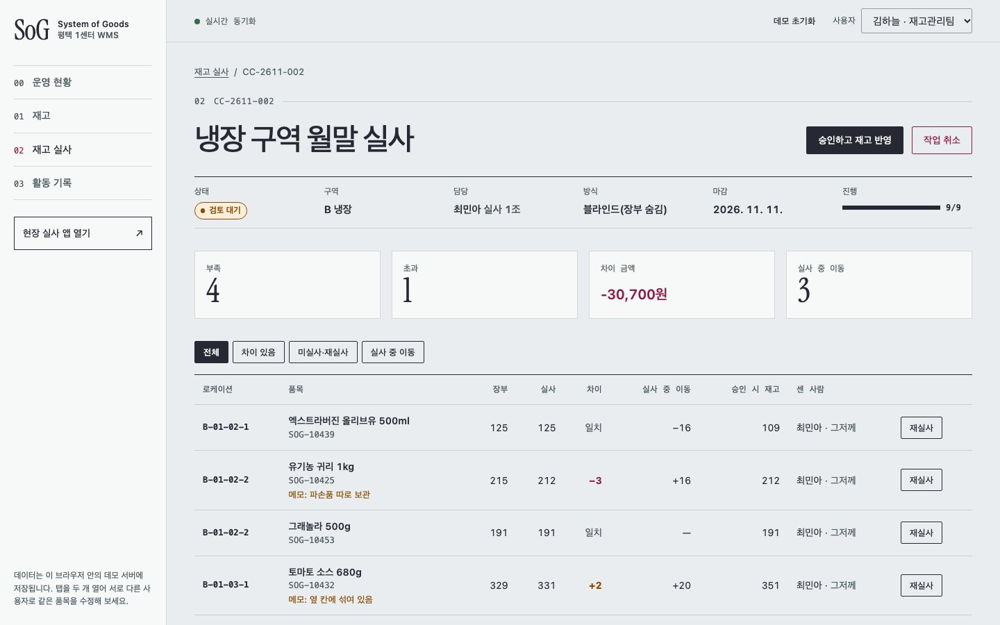
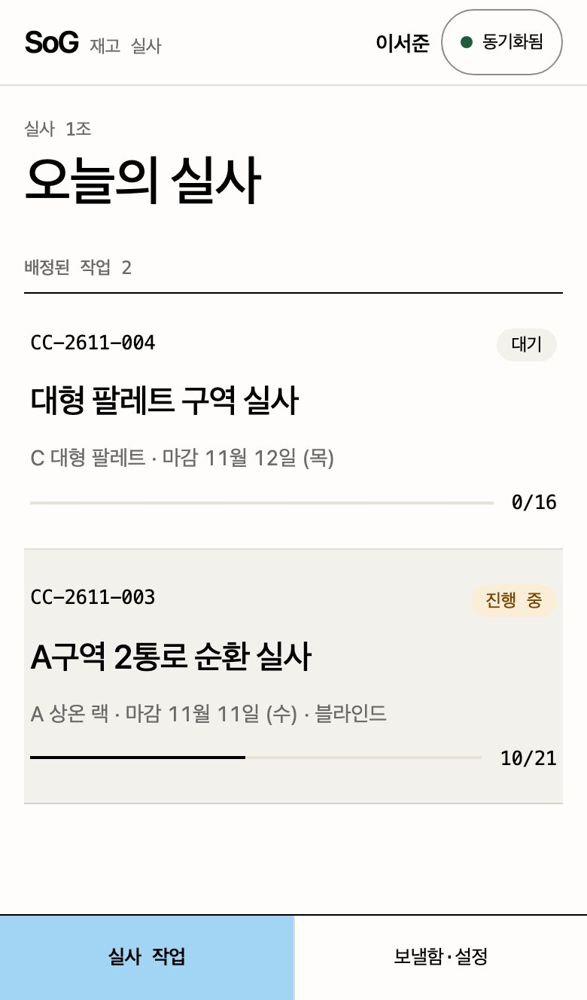
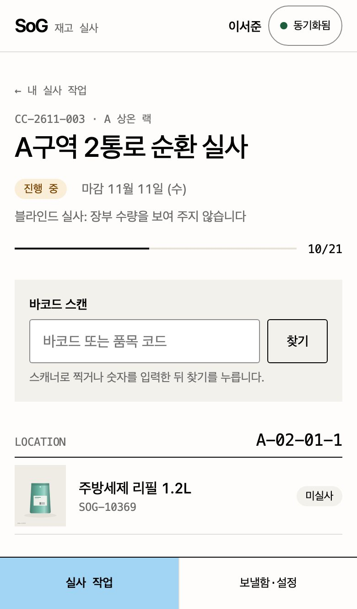

# SoG - System of Goods

[](https://github.com/ryushin01/SoG/actions/workflows/ci.yml)


물류창고의 재고를 관리하는 백오피스와, 창고 현장에서 재고 실사를 하는 작업자용 PWA를 한 저장소에 담은 모노레포입니다. 두 사람이 같은 재고를 동시에 고쳐도, 실사 도중 물건이 들고 나도, 음영 지역에서 연결이 끊겨도 재고가 어긋나지 않도록 동시성 제어에 집중했습니다.

**[백오피스 보기](https://sog-ryushin01.vercel.app/)** · **[현장 실사 앱 보기](https://sog-ryushin01.vercel.app/count/)** · **[Storybook](https://sog-ryushin01.vercel.app/storybook/backoffice)** · 로그인 없이 바로 쓸 수 있습니다. 같은 브라우저에서 두 앱을 열면 실사 앱에서 센 수량이 백오피스에 바로 나타납니다.

> **프로젝트 상태:** 실제 창고에 쓰지 않는 **포트폴리오 프로젝트**입니다. 백엔드 대신 브라우저 안의 데모 서버(IndexedDB)로 동작하며, 품목·작업자·재고는 모두 가상 데이터입니다.

## 화면

품목 사진은 이미지 파일 없이 코드(SVG)로 그렸습니다.

| 운영 현황 | 동시 수정 충돌 |
|---|---|
|  |  |

| 재고 목록 | 실사 검토 |
|---|---|
|  |  |

| 실사 앱 작업 목록 | 실사 앱 품목 실사 |
|---|---|
|  |  |

| 로케이션별 품목 | 오프라인 보낼함 |
|---|---|
|  |  |

## 주요 기능

**백오피스** (`apps/backoffice`, 주소 `/`)

| 기능 | 내용 |
|---|---|
| 운영 현황 | 재고 금액·수량, 부족·품절, 진행 중 실사, 재고 정확도, 14일 입출고 차트(키보드로 값 읽기, 표 보기), 구역별 재고, 최근 활동 |
| 재고 | 품목명·코드·바코드 검색, 분류·상태·구역 필터(주소에 남음), 열 정렬. 다른 탭에서 입출고가 일어나면 표가 바로 바뀜 |
| 품목 상세 | 기본 정보 수정, 로케이션별 재고 조정, 입고·출고·이동 등록, 이동 기록 |
| 재고 실사 | 구역 단위 작업 생성(블라인드 실사), 현장 진행 실시간 확인, 차이 검토, 재실사 요청, 승인 시 재고 반영 |
| 활동 기록 | 입출고, 실사, 정보 수정, 막아 낸 동시 수정 충돌 |

**현장 실사 앱** (`apps/count`, 주소 `/count/`, PWA)

| 기능 | 내용 |
|---|---|
| 작업 | 작업자를 고르면 배정된 실사 작업이 열림. 로케이션 순서로 묶은 품목 목록 |
| 품목 실사 | 사진 갤러리, 같은 품목의 다른 로케이션, 큰 −/+ 수량 입력, 블라인드 실사, 메모. 저장하면 다음 품목으로 |
| 바코드 | 현장 스캐너(키보드 입력)로 찍으면 해당 품목으로 이동 |
| 오프라인 | 센 수량은 기기 보낼함에 먼저 저장, 연결되면 자동으로 보냄. 진행 중 작업은 미리 받아 둠 |
| 설치 | 서비스 워커와 앱 매니페스트로 홈 화면에 설치, 연결이 끊긴 곳에서도 열림 |

**동시성 제어**: ETag·If-Match 낙관적 잠금(412 충돌 비교), Web Locks 쓰기 직렬화, 멱등 키, 실사 중 이동을 반영하는 정산 규칙, 중복 제출 잠금, BroadcastChannel 실시간 반영. 자세한 내용은 [동시성 제어](docs/concurrency.md)에 있습니다.

## 기술 스택


| 구분 | 사용 기술 |
|---|---|
| 구성 | pnpm 워크스페이스, Turborepo, Feature-Sliced Design v2.1 (Steiger로 검사) |
| 프레임워크 | Angular 22 (standalone, zoneless, signals, `@if`·`@for`, `@defer`, Signal Forms, `httpResource`), TypeScript 6 |
| PWA | @angular/service-worker, Web App Manifest |
| 데이터 | 브라우저 안 데모 서버: IndexedDB, Web Locks API, BroadcastChannel |
| 품질 | ESLint(angular-eslint, 템플릿 접근성 규칙), Prettier, husky + lint-staged, Vitest 5 + Testing Library + fake-indexeddb, Storybook 10(angular-vite) 스토리 테스트(실제 브라우저 + axe), Playwright + axe(프로덕션 빌드·배포 사이트 E2E) |
| 배포 | Vercel(두 앱을 한 주소로), GitHub Actions, Dependabot |

## 시작하기

Node.js 22 이상(`.nvmrc`)과 pnpm 12가 필요합니다.

```bash
corepack enable pnpm
pnpm install
pnpm dev    # 백오피스 http://localhost:4200 · 실사 앱 http://localhost:4200/count/
```

| 명령 | 설명 |
|---|---|
| `pnpm build` | 두 앱 프로덕션 빌드 |
| `pnpm preview` | 빌드한 두 앱을 배포 구조로 띄움(http://localhost:4300, 서비스 워커 확인용) |
| `pnpm test` | 데모 서버, 도메인 규칙, 두 앱 컴포넌트 테스트 |
| `pnpm test:storybook` | 모든 스토리를 실제 브라우저에서 렌더링하고 접근성 검사 |
| `pnpm e2e` | 프로덕션 빌드 E2E (먼저 `build` 필요, `E2E_BASE_URL`을 주면 배포된 사이트 검사) |
| `pnpm typecheck` / `pnpm lint` | 타입 검사 / ESLint와 FSD 규칙 검사(Steiger) |
| `pnpm --filter @sog/backoffice storybook` | 백오피스 Storybook (`http://localhost:6006`) |

## 프로젝트 구조

```
apps/
├─ backoffice/   WMS 백오피스 (FSD: app · pages · widgets · features · entities · shared)
└─ count/        현장 재고 실사 PWA (FSD)
packages/
├─ domain/       타입, 재고 규칙, 실사 정산, 품목 그림(SVG)
├─ wms-server/   브라우저 안 데모 서버
└─ wms-client/   Angular HTTP 연결, 변경 알림, 네트워크 상태, 중복 제출 잠금
e2e/             프로덕션 빌드 E2E
docs/            문서와 스크린샷
```

## 문서

| 문서 | 내용 |
|---|---|
| [동시성 제어](docs/concurrency.md) | 낙관적 잠금, 쓰기 직렬화, 멱등 키, 실사 정산, 화면 쪽 경쟁, 오프라인 |
| [개발 가이드](docs/development.md) | 구조, Angular 사용 방식, FSD, 개발 서버, 테스트, 접근성 점검 |
| [디자인](docs/design.md) | 참고 사이트, 두 앱의 디자인 토큰, 품목 그림 |
| [CI · 배포](docs/ci-deploy.md) | GitHub Actions, Vercel, 배포된 사이트 검사, Dependabot |
| [버전 기록](CHANGELOG.md) | 버전별 변경 내용 |
