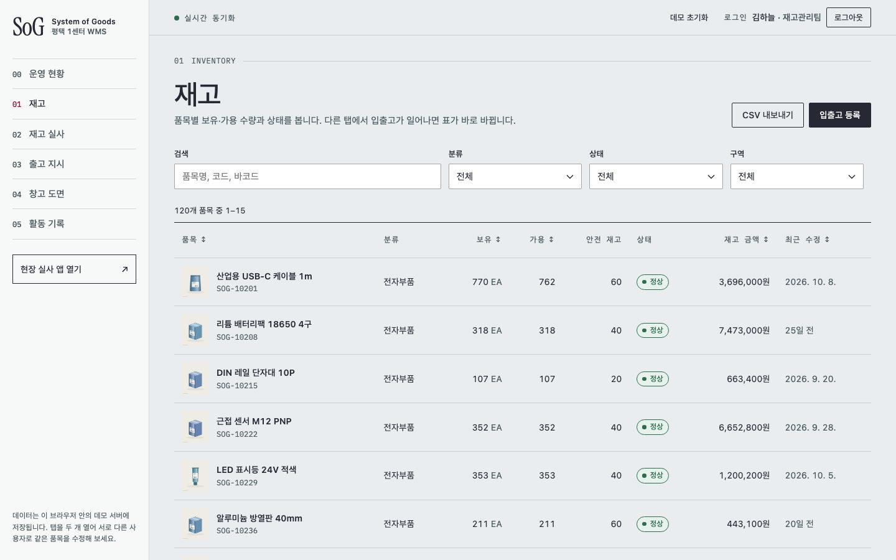
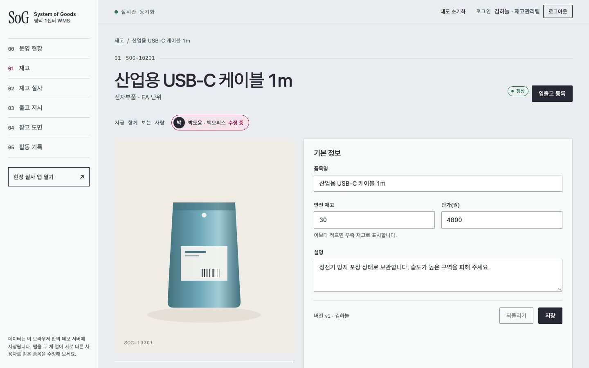
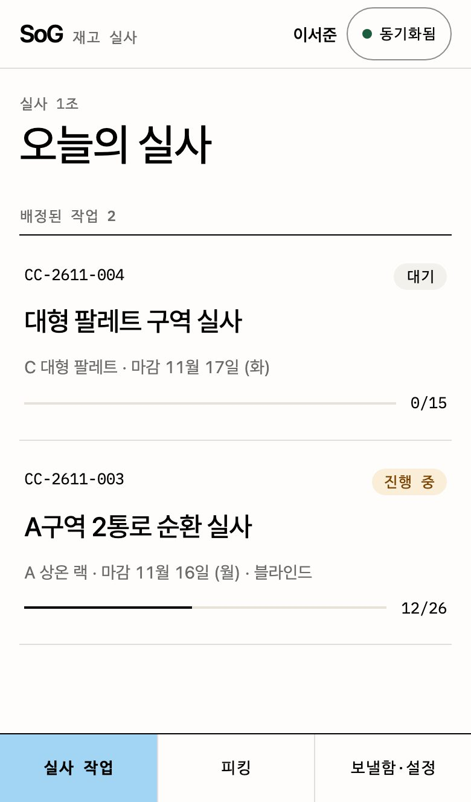
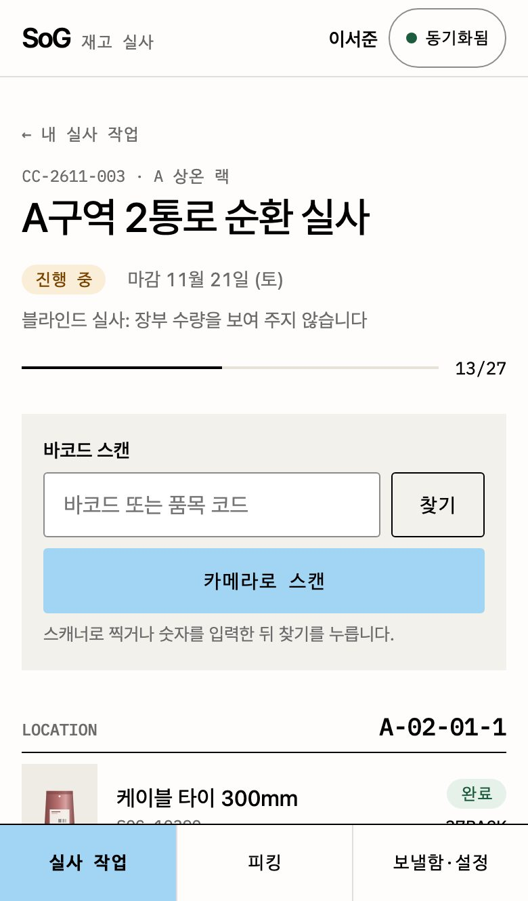
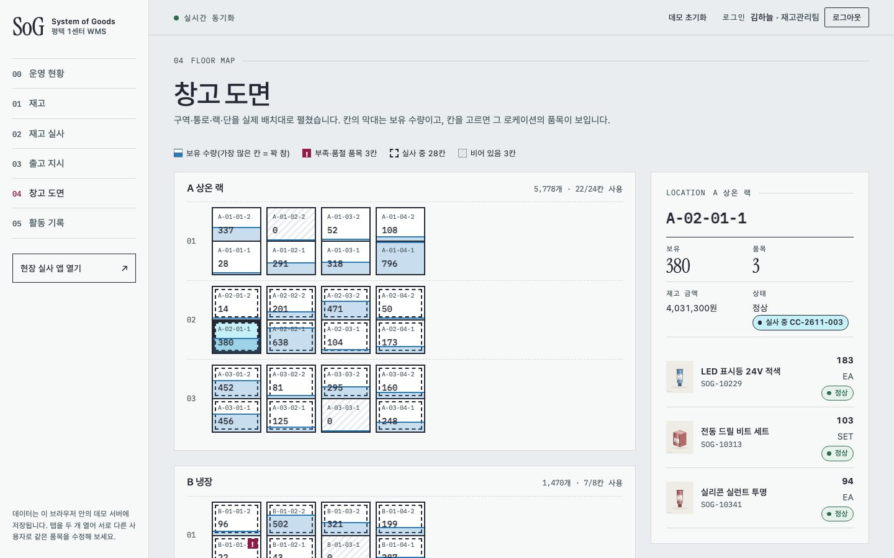
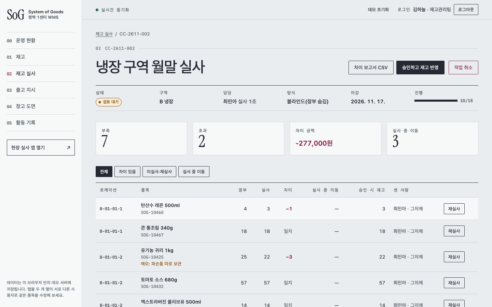
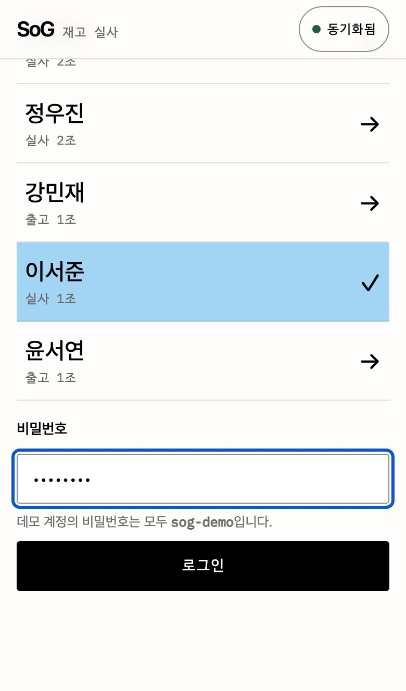
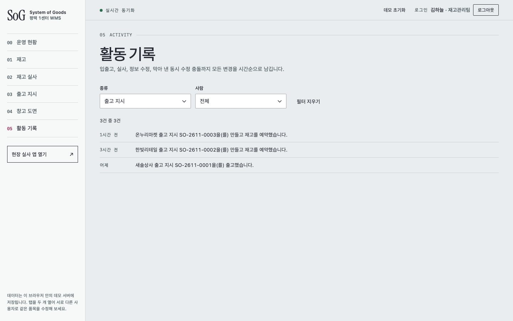
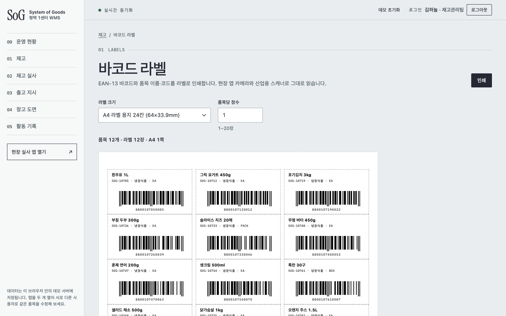
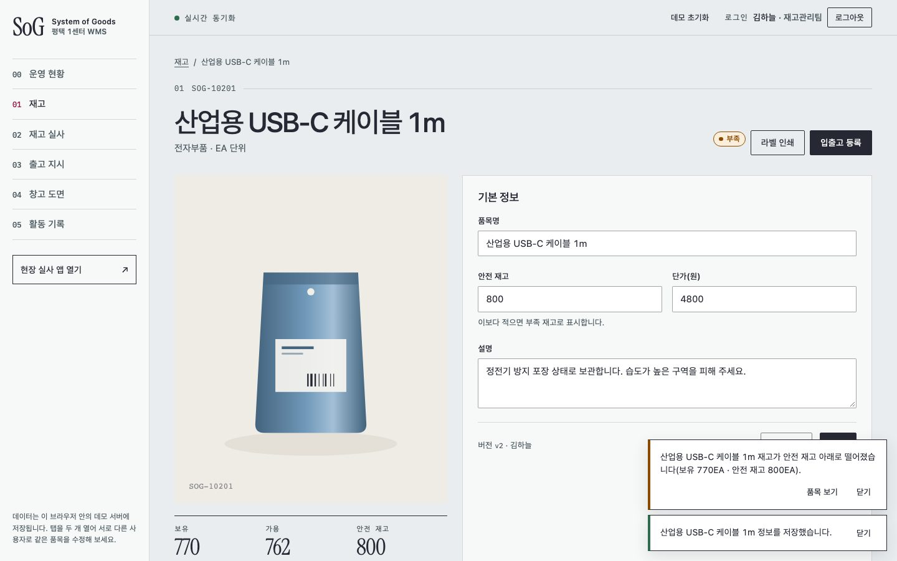

# 디자인

두 앱은 쓰는 사람과 장소가 달라 디자인 언어를 따로 잡았습니다. 참고 사이트의 분위기를 옮겼고, 로고·사진·글은 쓰지 않았습니다.

## 백오피스: 계기판 같은 관리 화면

참고: [Mecha Capital](https://mecha-xyz.webflow.io/)의 산업적인 분위기

| 요소 | 적용 |
|---|---|
| 바탕 | 강철빛 회색 `#e9edef`, 면 `#f7f8f8` |
| 글자 | 짙은 남회색 `#262933`, 보조 `#4c5a60`(참고 사이트의 `#687980`은 대비 3.9:1이라 진하게 바꿈) |
| 포인트 | 적갈색 `#911a46`(선택된 메뉴 번호, 위험 버튼, 충돌 안내), 하늘색 `#c5f0f7`(안내 바탕) |
| 글꼴 | 숫자와 브랜드는 세리프(Instrument Serif, 앱과 함께 내보냄), 한글은 수트(SoGSans), 코드·수량·캡션은 IBM Plex Mono(라틴 글자만) |
| 구성 | 번호 붙은 메뉴와 섹션(`00 OVERVIEW`, `01 FLOW`), 가는 선, 큰 세리프 수치 |
| 차트 | 입고 `#2b7bb9`, 출고 `#b8456a`. 팔레트 검증(밝기, 채도, 색각 이상 ΔE 13.5, 대비 3:1)을 통과한 조합 |

## 현장 실사 앱: 상품 상세처럼 또렷한 화면

참고: [Heirest](https://heirest.com/)의 상품 상세 페이지

| 요소 | 적용 |
|---|---|
| 바탕 | 미색 `#fefdfc`, 돌색 `#f3f1ec` |
| 글자 | 검정, 보조 `#6b6b6b` |
| 버튼 | 3px 모서리의 윤곽선 버튼이 누르거나 올리면 하늘색 `#a2d4f3`으로 채워짐 |
| 글꼴 | 운영체제 고딕(현장 기기에서 빠르게), 코드·수량·캡션·버튼은 IBM Plex Mono(라틴 400·500 두 파일 32KB, 서비스 워커가 미리 받아 오프라인에서도 같은 모양) |
| 품목 화면 | 큰 사진 갤러리(정면·측면·라벨, 좌우로 넘김) + 정보 열. 같은 품목의 다른 로케이션을 색상 스와치처럼, 상세 정보는 가는 선 사이의 접힘 목록으로 |
| 조작 | 수량 −/+ 버튼과 입력란을 한 덩어리로, 최소 48px. 아래쪽 탭은 엄지가 닿는 곳 |

## 품목 그림

사진 대신 코드로 그립니다(`packages/domain/src/art.ts`). 품목마다 모양(상자, 병, 캔, 파우치, 튜브, 롤)과 색상값을 정해 두고, 그라데이션·라벨·바코드를 얹어 스튜디오 제품 사진처럼 보이게 합니다. 시점은 정면, 측면(기울임), 라벨 확대 세 가지입니다.

## 바코드 라벨

라벨 화면의 미리보기는 실제 크기(mm)로, 흰 종이에 붙인 라벨처럼 그립니다. A4 라벨 용지(3×8칸, 64×33.9mm, 쪽 여백 12.9·6.5mm)와 라벨 프린터(50×30mm, 라벨 하나가 한 쪽) 두 가지이고, 인쇄할 때는 메뉴·머리글·설정을 감추고 `@page`로 용지 크기를 정합니다. 라벨에는 이름(두 줄까지), 코드·분류·단위, EAN-13 바코드를 둡니다. 바코드는 이미지 없이 막대를 SVG로 그리고(`packages/domain/src/barcode.ts`), 가드 막대를 길게 두며, 색은 화면 테마와 상관없이 흰 바탕에 검정입니다.

## 화면

README에 싣지 않은 화면입니다.

| 재고 목록 | 함께 보는 사람 |
|---|---|
|  |  |

| 실사 앱 작업 목록 | 로케이션별 품목 |
|---|---|
|  |  |

| 창고 도면 | 실사 검토 |
|---|---|
|  |  |

| 현장 앱 로그인 | 활동 기록 |
|---|---|
|  |  |

| 바코드 라벨 | 안전 재고 알림 |
|---|---|
|  |  |
