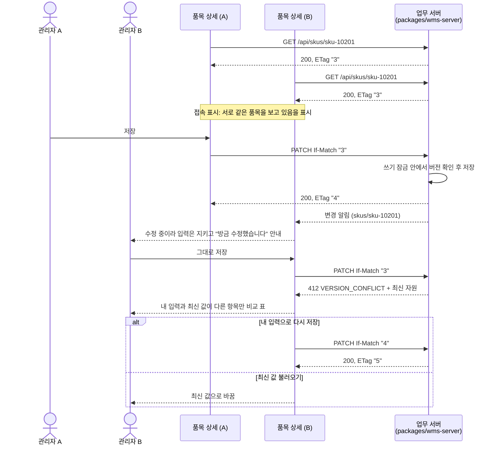
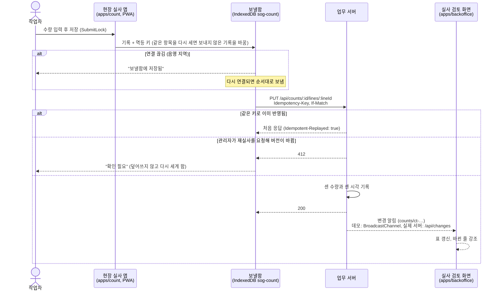
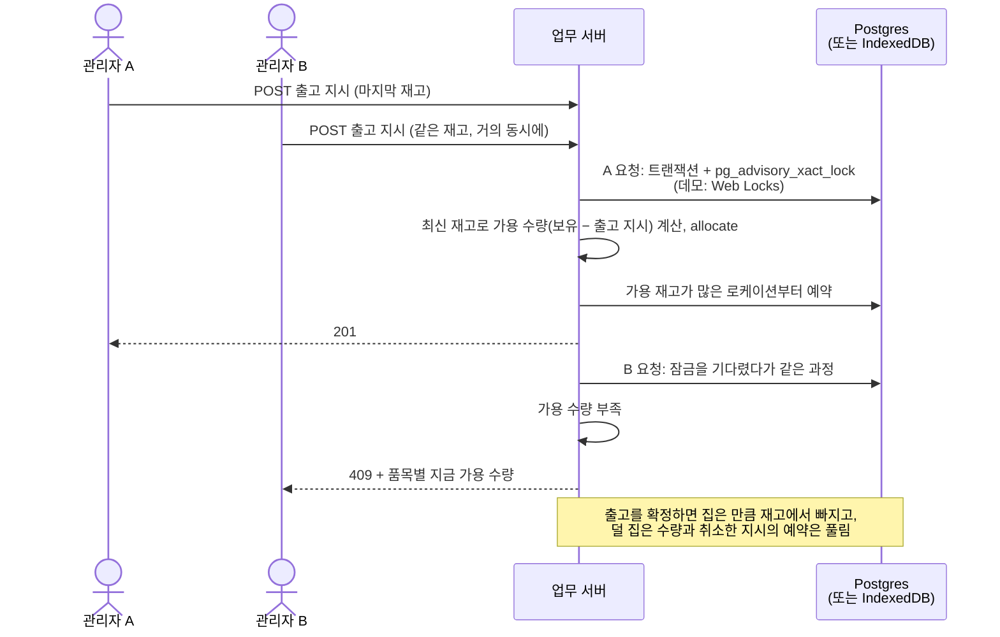
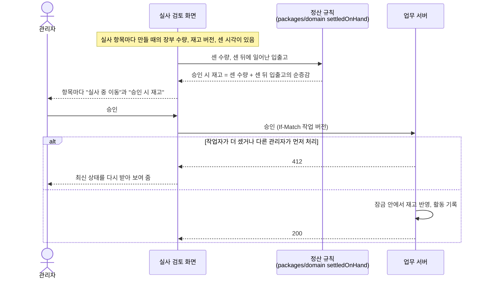

# 시퀀스 다이어그램

SoG의 주요 흐름입니다. 원리와 근거는 [동시성 제어](concurrency.md)와 [실제 서버](backend.md)에 있고, 여기서는 시간 순서로 그립니다. 업무 서버는 운영에서는 Postgres 위의 Vercel 함수, 개발·미리보기에서는 브라우저 안(IndexedDB)의 데모 서버이며, 두 앱은 `@sog/wms-client`의 `HttpClient`로만 통신합니다.

## 1. 두 관리자가 같은 품목을 고칠 때 (낙관적 잠금)

## 2. 현장 실사: 오프라인 보낼함과 실시간 반영

## 3. 출고 지시의 재고 예약

## 4. 실사 승인 정산

